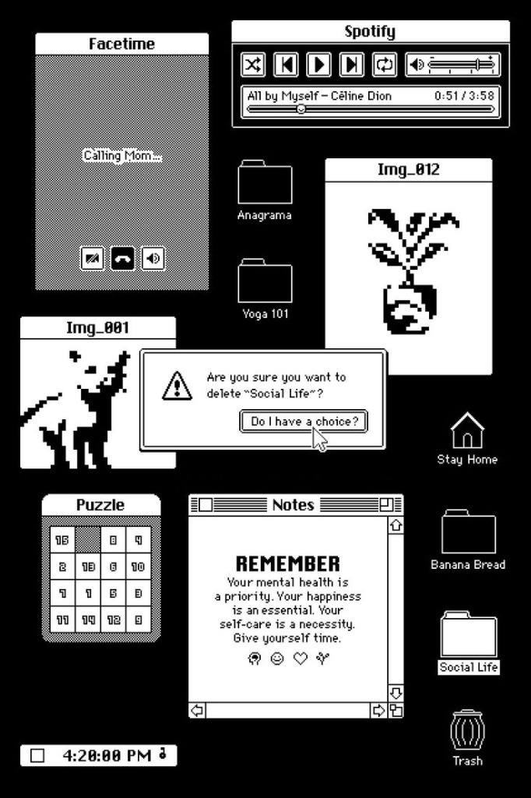
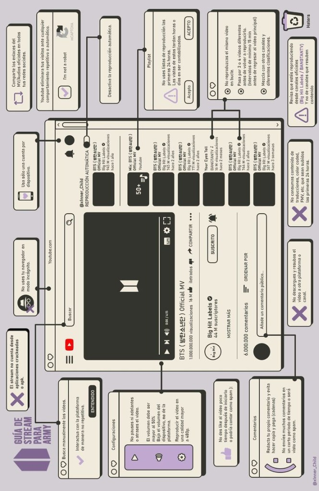

# Draftlight — Design & UI Specification

## 1. Visual Identity & Mood

**Draftlight** combines the tactile nostalgia of **classic personal computing (Mac System 6/7, early desktop GUIs)** with a calm place to return to unfinished work.

Rather than looking like a generic project-management dashboard or corporate AI chat interface, Draftlight embraces:
- **Classic OS window chrome:** Crisp solid borders, subtle horizontal pinstripe titlebars, and tactile hard-drop shadows (`box-shadow: 2px 2px 0px #000`).
- **Tactile editorial surfaces:** Warm newsprint / paper textures, dithered halftones, and vintage dialog boxes.
- **Content-first focus:** The user's project context is the visual priority, regardless of the kind of work.
- **Quiet assistance:** The AI companion behaves like a supporting desktop utility rather than an overbearing chatbot.

The design stays minimal, monochrome, and neutral. Retro references add texture and character; they do not justify colorful category systems or ornamental complexity.

---

## 2. Visual References & Aesthetic Influences

Draftlight's visual system references two core design artifacts:

### Reference 1: 1-Bit Retro Monochrome Desktop

- **Source Artifact:** `docs/assets/reference_retro_monochrome.jpg`
- **Key Characteristics:**
  - Pure binary contrast: Stark black (`#000000`) and paper white (`#FFFFFF`).
  - Dithered halftone patterns (checkerboard pixel stippling) for secondary window states, scroll bars, and dividers.
  - Double-bordered dialog windows with classic beveled buttons (`"Do I have a choice?"`).
  - Pixelated iconography and bitmap typography reminiscent of classic Macintosh System 6 and HyperCard.

### Reference 2: Vintage Mac OS Paper & Pastel Desktop

- **Source Artifact:** `docs/assets/reference_warm_mac_retro.jpg`
- **Key Characteristics:**
  - Warm parchment / newsprint background with alabaster window cards.
  - Classic Mac OS horizontal pinstripe titlebars and dot/pill controls.
  - Soft retro accent palette: muted lilac/lavender, sage green, and dust charcoal.
  - Structured, boxed callout notes with bold uppercase headers and clean border outlines.

---

## 3. Color Palette & Theming

The current interface uses one restrained paper-and-ink system. Black, off-white, and neutral gray establish hierarchy; any accent must be rare, functional, and accessible. Project categories must not receive their own colors or themes.

### A. Primary Theme: "Paper & Ink" (Warm Retro Desktop — Ref. 2)
This is the implemented default and the baseline for future UI work.

| Token Name | Value | Purpose & Usage |
|---|---|---|
| `--ink` | `#151515` | Primary text, dark sidebar, and strongest controls |
| `--ink-raised` | `#282828` | Active and hovered dark surfaces |
| `--paper` | `#F6F4EF` | Main workspace and high-contrast text on dark surfaces |
| `--paper-deep` | `#ECE9E2` | Companion and desktop surfaces |
| `--muted` | `#696863` | Secondary labels, timestamps, and hints |
| Optional accent | Restrained neutral or amber | Reserved for focus and a single primary action; never used as a project category |
| `--line` | `#D9D5CD` | Quiet dividers and workspace structure |
| `--line-strong` | `#BBB7AE` | Stronger separators and control boundaries |

### B. High-Contrast Mode: "1-Bit Midnight" (Monochrome Retro — Ref. 1)
This is a possible accessibility extension, not part of the current MVP commitment. It must preserve the same hierarchy and interactions if implemented later.

| Token Name | Hex Code | Purpose & Usage |
|---|---|---|
| `--mono-bg` | `#0D0E11` / `#000000` | Deep black desk canvas |
| `--mono-surface` | `#16181D` / `#000000` | Black window with crisp white borders |
| `--mono-border` | `#FFFFFF` | 2px solid white borders and double-line dialogs |
| `--mono-text` | `#FFFFFF` | High-contrast pixel/mono text |
| `--mono-dither` | `repeating-conic-gradient(#fff 0 25%, #000 0 50%)` | 50% checkerboard stippling for inactive panes |
| `--mono-shadow` | `3px 3px 0px #FFFFFF` | White retro hard drop-shadow |

---

## 4. Typography System

The typography pairs early computer interface fonts with a comfortable serif for reading and editing user-provided context.

### Font Families & Roles

| Context | Font Family | Fallback Stack | Role / Characteristic |
|---|---|---|---|
| **Content Workspace** | `Lora` or `Merriweather` | `Georgia, serif` | Warm, readable serif (18px, 1.75 line-height) for sustained work without eye fatigue. |
| **Window Titles & Headers** | `Departure Mono` or `Chicago` | `Courier New, monospace` | Bold retro desktop feel; uppercase with subtle tracking (`letter-spacing: 0.05em`). |
| **UI Controls & Buttons** | `Space Grotesk` or `Inter` | `system-ui, sans-serif` | Crisp, legible 13px–14px medium/semibold for buttons, menus, and badges. |
| **Stats & Metadata** | `IBM Plex Mono` or `VT323` | `monospace` | Monospaced word count, time elapsed, and Ollama model status (`12px, tabular-nums`). |

### Typographic Hierarchy & Scale

- **App / Window Title:** 14px bold, uppercase, tracked (`LETTER-SPACING: 0.08em`).
- **Project Title:** 24px bold serif (`Lora`, line-height: 1.3).
- **Context Editor:** 18px regular serif, line-height 1.75, max-width 680px for a comfortable reading measure.
- **Section Headers (Companion):** 11px uppercase bold with border underline (e.g., `── ✦ NEXT STEPS ──`).
- **AI Suggestion Body:** 15px sans-serif or clean serif, line-height 1.6.
- **Status Badges / Counters:** 12px monospaced (`WORDS: 1,240 | CHARS: 6,810`).

---

## 5. UI Elements & Component Styling

### A. Window Chrome (Classic Desktop Frame)
- **Borders:** Use `var(--ink)` or `var(--line)` according to hierarchy; reserve the strongest border for major panel boundaries.
- **Title Bar:**
  - Height: 32px with centered bold title.
  - Background: Crisp solid with subtle retro horizontal pinstripes where they do not reduce legibility.
  - Left control: Square retro close/minimize box (`14px × 14px` bordered square).
- **Elevation:** If elevation is needed, use a hard `var(--ink)` drop-shadow with no soft blur.

### B. Retro Buttons & Controls
- **Standard Button:** Off-white background, 1.5px solid dark border, hard shadow (`2px 2px 0px #1E1E22`).
- **Active / Pressed State:** Shifts down-right by 2px (`transform: translate(2px, 2px); box-shadow: 0px 0px 0px;`).
- **Primary analysis action:** A clearly labeled neutral button with a small Lucide sparkle icon where appropriate.

### C. AI Assistance Area

The companion area supports the workspace without competing with it:

- Show a concise current-state summary first.
- Group unfinished parts, blockers, and unclear areas with plain labels.
- Present a few practical next steps as neutral memo-style cards; do not color-code them by project type.
- Keep suggestions visibly separate from user-created content.
- Provide only explicit, user-controlled actions such as copy or apply; never imply that a suggestion was inserted automatically.

---

## 6. Layout Architecture (Split Workspace)

The three areas are a project library, a central context workspace, and a narrower assistance panel. The workspace receives the most space; assistance stays secondary. Labels and empty states remain project-neutral.

```
┌────────────────────────────────────────────────────────────────────────────────────────┐
│ [■] DRAFTLIGHT v1.0 ═════════════════════════════════════════════════════ [? Help] [⚙] │
├─────────────────┬──────────────────────────────────────────┬───────────────────────────┤
│ PROJECTS        │ TITLE: Community Garden Plan             │ ✦ COMPANION               │
│ ═══════════════ │ ════════════════════════════════════════ │ ═════════════════════════ │
│ [ + New Project]│                                          │ [ Review Project ]        │
│                 │ Goal: prepare the shared garden beds     │                           │
│ 🗀 Garden Plan  │ before the volunteer day.                │ ── CURRENT STATE ─────────│
│   1,240 words   │                                          │ Two decisions remain open.│
│                 │                                          │ Owners need confirmation. │
│ 🗀 Launch Notes │                                          │                           │
│   450 words     │                                          │ ── NEXT STEPS ────────────│
│                 │                                          │ ┌─ 1. Confirm owners ────┐│
│                 │                                          │ │ List the three leads.  ││
│                 │                                          │ └───────────────────────┘ │
│                 │                                          │ [Copy] [Apply deliberately]│
├─────────────────┴──────────────────────────────────────────┴───────────────────────────┤
│ [● Ollama: llama3.2:3b]               WORDS: 1,240 | CHARS: 6,810            4:20 PM ♫│
└────────────────────────────────────────────────────────────────────────────────────────┘
```

---

## 7. Interaction States & Transitions

1. **Dithered Loading / Inference:**
   - When Ollama is analyzing or generating, the Companion panel displays a gentle animated 1-bit dither sweep or marquee line (`░▒▓█▓▒░`) instead of modern generic spinning wheels.
2. **Offline Warning:**
   - Show a concise inline or dialog message that local AI is unavailable, how to retry, and that project editing remains available.
3. **Save State Indicator:**
   - Monospaced indicator in the bottom bar switching between `[• UNMODIFIED]` and `[✓ SAVED TO DISK]`.
